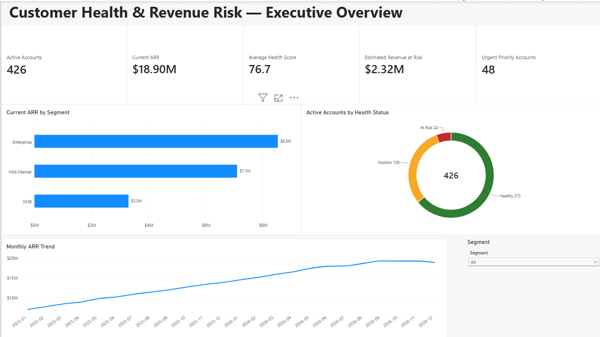
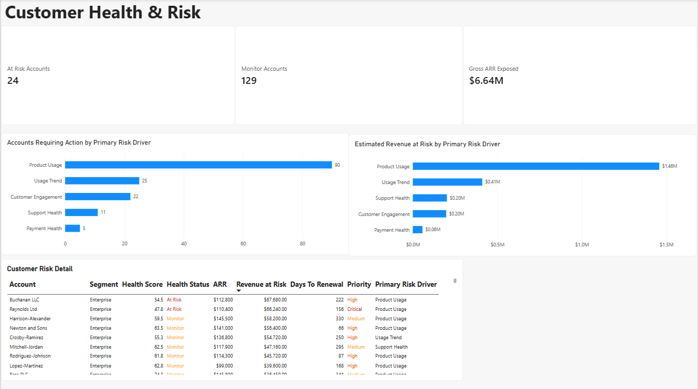
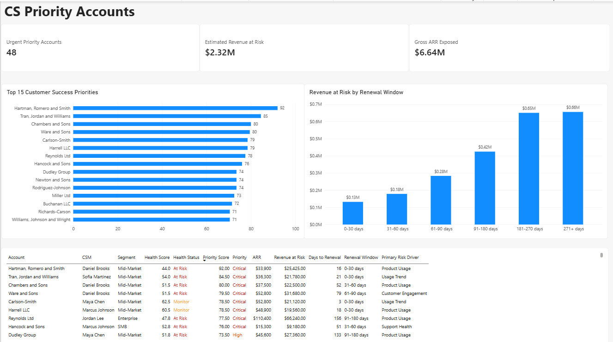
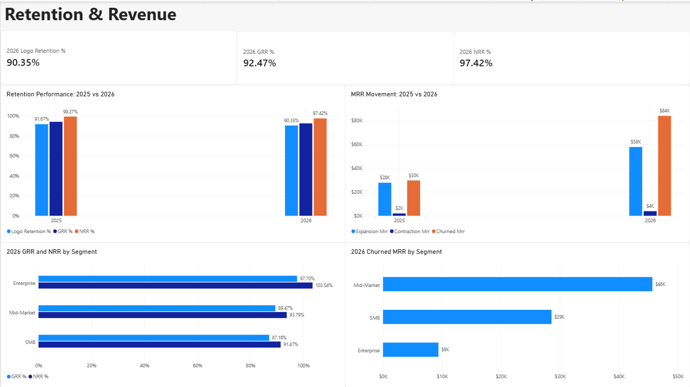
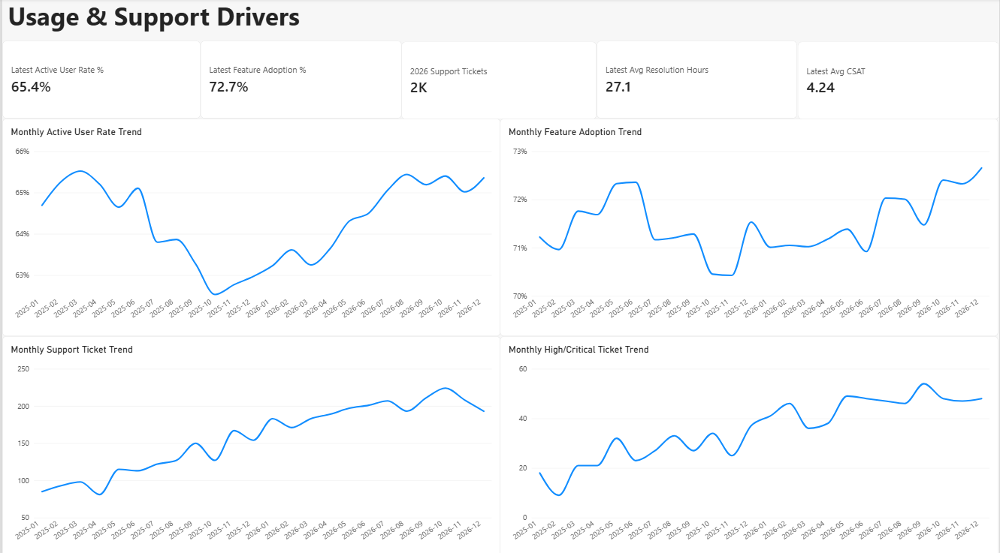

# Customer Health & Revenue Risk Analytics

An end-to-end analytics portfolio project that simulates how a B2B SaaS company can identify customer health deterioration, estimate recurring revenue exposure, prioritize Customer Success interventions, and monitor retention performance.

The project combines **PostgreSQL, SQL, Python, Power BI, and DAX** to turn six operational datasets into an explainable customer-health and revenue-risk decision system.

> **Note:** All customer and business data in this project is synthetic and was generated specifically for analytical practice.

---

## Business Problem

CloudPath Analytics is a fictional B2B SaaS company that provides operational analytics, dashboards, alerts, workflow monitoring, and reporting tools.

The Customer Success organization needs to answer several questions:

- Which customers are showing signs of declining health?
- What signals are contributing to customer risk?
- How much recurring revenue is associated with customers requiring attention?
- Which accounts should Customer Success contact first?
- Which customers are approaching renewal?
- How are retention and recurring revenue changing over time?
- Which customer segments have the strongest and weakest retention?
- How are product adoption and support activity changing?

The primary stakeholder for the analysis is the **VP of Customer Success**, with additional relevance for Customer Success Managers, Revenue Operations, Finance, Product, and executive leadership.

---

## Project Objectives

The project was designed to:

1. Build a relational PostgreSQL database representing a realistic B2B SaaS customer environment.
2. Generate and clean synthetic operational data with realistic quality issues.
3. Develop reusable SQL analysis for customer health and revenue risk.
4. Create an explainable Customer Health Score using multiple business signals.
5. Estimate scenario-based Revenue at Risk.
6. Prioritize Customer Success interventions using account health, ARR, and renewal timing.
7. Analyze Logo Retention, Gross Revenue Retention, and Net Revenue Retention.
8. Create a five-page Power BI dashboard for executive and operational decision-making.

---

## Technology Stack

- **PostgreSQL** — relational database and analytical SQL
- **SQL** — joins, CTEs, CASE logic, window functions, aggregations, views, cohort and retention analysis
- **Python** — synthetic data generation and data cleaning
- **Faker** — synthetic customer and operational records
- **Power BI** — data model, dashboards, interactive filtering, and visualization
- **DAX** — business measures and dashboard KPIs
- **Git / GitHub** — version control and portfolio documentation

---

## Data Model

The analytical database contains six core tables.

### Accounts

Customer master data including:

- customer segment
- region
- industry
- signup date
- customer status
- churn date
- assigned Customer Success Manager

### Subscriptions

Subscription and recurring-revenue data including:

- plan
- billing frequency
- MRR
- subscription dates
- renewal date
- subscription status

### Product Usage

Monthly product-behavior data including:

- licensed users
- active users
- login activity
- dashboard usage
- reports generated
- alerts created
- feature adoption

### Support Tickets

Support activity including:

- ticket priority
- issue category
- ticket status
- resolution time
- customer satisfaction score

### Invoices

Billing and payment behavior including:

- invoice amount
- payment status
- payment date
- days late
- payment method

### Customer Success Interactions

Customer Success engagement including:

- interaction type
- engagement status
- Customer Success Manager
- follow-up requirement
- interaction category
- next follow-up date

---

## Dataset Scale

The final PostgreSQL database contains:

| Dataset | Rows |
|---|---:|
| Accounts | 500 |
| Subscriptions | 980 |
| Product Usage | 8,184 |
| Support Tickets | 3,792 |
| Invoices | 4,420 |
| Customer Success Interactions | 3,086 |

The primary analytical period is **January 2025 through December 2026**.

The current December 2026 snapshot contains:

- **426 active customer accounts**
- **$1.57M monthly recurring revenue**
- **$18.90M annual recurring revenue**

---

## Data Quality

The synthetic datasets intentionally included realistic data-quality problems such as:

- duplicate records
- missing values
- inconsistent category labels
- invalid dates
- negative values
- inconsistent payment statuses
- invalid usage metrics
- inconsistent boolean values
- missing Customer Success assignments

Cleaning scripts were created before loading the data into PostgreSQL.

A final database-validation layer checks:

- expected table row counts
- primary-key uniqueness
- foreign-key integrity
- account and subscription consistency
- usage constraints
- support-ticket rules
- invoice rules
- Customer Success interaction rules
- recurring-revenue reconciliation

---

## Customer Health Framework

The Customer Health Score combines six explainable business components.

| Component | Weight |
|---|---:|
| Product Usage | 25% |
| Usage Trend | 20% |
| Feature Adoption | 15% |
| Support Health | 15% |
| Payment Health | 10% |
| Customer Engagement | 15% |

Accounts are classified into:

- **Healthy:** 75–100
- **Monitor:** 55–74
- **At Risk:** below 55

Current results:

| Health Status | Accounts |
|---|---:|
| Healthy | 273 |
| Monitor | 129 |
| At Risk | 24 |

The model is intentionally explainable and designed as Customer Success decision support rather than a black-box churn prediction model.

---

## Revenue at Risk

The project distinguishes between two different concepts.

### Gross ARR Exposed

ARR associated with customers requiring Customer Success attention.

**Gross ARR Exposed: approximately $6.64M**

### Estimated Revenue at Risk

A scenario-based estimate that applies different revenue-exposure assumptions according to customer health.

**Estimated Revenue at Risk: approximately $2.32M**

This value is used for prioritization and should not be interpreted as a guaranteed churn forecast.

---

## Customer Success Prioritization

A separate prioritization model determines which customers Customer Success should contact first.

The model considers:

- customer health severity
- account ARR
- renewal timing
- modeled revenue exposure

The current model identifies:

**48 Critical or High priority accounts**

This allows the Customer Success team to distinguish between:

- customers requiring immediate intervention,
- accounts that need structured monitoring,
- and customers where preventive adoption work can still be performed before renewal.

---

## Retention Analysis

The project calculates:

- Logo Retention
- Gross Revenue Retention (GRR)
- Net Revenue Retention (NRR)
- Expansion MRR
- Contraction MRR
- Churned MRR

### Overall Retention

| Metric | 2025 | 2026 |
|---|---:|---:|
| Logo Retention | 91.67% | 90.35% |
| GRR | 94.05% | 92.47% |
| NRR | 99.27% | 97.42% |

Retention weakened in 2026 despite stronger expansion activity because churned recurring revenue also increased.

### 2026 Retention by Segment

| Segment | GRR | NRR |
|---|---:|---:|
| Enterprise | 97.70% | 103.54% |
| Mid-Market | 89.47% | 93.79% |
| SMB | 87.16% | 91.47% |

Enterprise is the only segment with NRR above 100%.

---

## Key Business Findings

### Product usage is the dominant risk driver

Product Usage is the primary risk driver for **90 of the 153 accounts requiring action**.

Approximately **$1.46M of modeled Revenue at Risk** is associated with Product Usage.

This suggests that adoption problems may provide an earlier warning signal than billing problems alone.

### Customer risk exists well before renewal

Revenue exposure exists across every renewal horizon.

A substantial amount of modeled revenue exposure belongs to accounts more than six months away from renewal.

This supports proactive adoption programs rather than waiting until customers enter the final renewal window.

### Mid-Market creates the largest absolute churn impact

In 2026, approximately:

- Mid-Market churned MRR: **$46K**
- SMB churned MRR: **$29K**
- Enterprise churned MRR: **$9K**

SMB has weaker retention percentages, while Mid-Market generates the largest absolute recurring-revenue loss.

### Enterprise customers retain and expand more effectively

Enterprise NRR reached approximately **103.54%** in 2026.

This suggests that the company should investigate whether successful Enterprise Customer Success practices can be adapted for other segments.

### Support demand increased over time

Product usage recovered during 2026, but support-ticket volume and High/Critical ticket volume also generally increased.

This suggests that support capacity should be monitored alongside product adoption.

---

## Recommended Business Actions

Based on the analysis, CloudPath Analytics should:

1. Review Critical and High priority accounts during recurring Customer Success operating reviews.
2. Prioritize direct intervention for accounts approaching renewal within 90 days.
3. Launch proactive adoption programs for customers showing weak Product Usage or Usage Trend signals.
4. Focus Mid-Market retention initiatives on reducing absolute recurring-revenue loss.
5. Develop scalable onboarding and lifecycle programs for SMB customers.
6. Study successful Enterprise retention and expansion patterns.
7. Monitor support capacity as product adoption increases.
8. Track Health Score, Revenue at Risk, renewal exposure, GRR, NRR, and Logo Retention together.

---

## Power BI Dashboard

The Power BI report contains five pages.

### 1. Executive Overview

Provides an executive view of:

- active customers
- current ARR
- average health score
- estimated Revenue at Risk
- urgent priority accounts
- ARR by segment
- health-status distribution
- monthly ARR trend



### 2. Customer Health & Risk

Analyzes:

- At Risk and Monitor accounts
- Gross ARR exposure
- primary customer-risk drivers
- Revenue at Risk by risk driver
- detailed account-level risk information



### 3. CS Priority Accounts

Supports Customer Success operations through:

- urgent account counts
- prioritized account ranking
- revenue exposure by renewal window
- account-level Customer Success priority detail



### 4. Retention & Revenue

Tracks:

- Logo Retention
- GRR
- NRR
- expansion MRR
- contraction MRR
- churned MRR
- segment-level retention performance



### 5. Usage & Support Drivers

Tracks:

- active-user rate
- feature adoption
- support-ticket volume
- resolution time
- CSAT
- High/Critical support-ticket trends



---

## Repository Structure

```text
customer-health-revenue-risk/
│
├── README.md
├── requirements.txt
├── .gitignore
│
├── data/
│   ├── raw/
│   └── processed/
│
├── docs/
│   ├── 01_business_understanding.md
│   ├── 02_data_model.md
│   └── 03_business_findings.md
│
├── python/
│   ├── generate_synthetic_data.py
│   ├── clean_accounts.py
│   ├── generate_subscriptions.py
│   ├── clean_subscriptions.py
│   ├── generate_product_usage.py
│   ├── clean_product_usage.py
│   ├── generate_support_tickets.py
│   ├── clean_support_tickets.py
│   ├── generate_invoices.py
│   ├── clean_invoices.py
│   ├── generate_cs_interactions.py
│   └── clean_cs_interactions.py
│
├── sql/
│   ├── 01_create_database.sql
│   ├── 02_create_tables.sql
│   ├── 03_schema_validation.sql
│   ├── 04_load_accounts.sql
│   ├── 05_load_subscriptions.sql
│   ├── 06_load_product_usage.sql
│   ├── 07_load_support_tickets.sql
│   ├── 08_load_invoices.sql
│   ├── 09_load_cs_interactions.sql
│   ├── 10_full_database_validation.sql
│   └── ...
│
├── powerbi/
│   └── Customer_Health_Revenue_Risk.pbix
│
└── images/
    ├── 01_executive_overview.png
    ├── 02_customer_health_risk.png
    ├── 03_cs_priority_accounts.png
    ├── 04_retention_revenue.png
    └── 05_usage_support_drivers.png
```

---

## Running the Project Locally

### 1. Create the Python environment

```bash
python -m venv .venv
```

Activate the virtual environment and install:

```bash
pip install -r requirements.txt
```

### 2. Generate and clean the synthetic datasets

Run the generation and cleaning scripts in the `python/` directory.

### 3. Create the PostgreSQL database

Execute the SQL scripts in numerical order.

The project database is:

```text
cloudpath_analytics
```

### 4. Validate the database

Run:

```text
sql/10_full_database_validation.sql
```

before beginning the analytical SQL layer.

### 5. Run the analytical SQL

Execute the remaining SQL scripts in numerical order to create the analytical views, health scoring, revenue-risk calculations, prioritization logic, retention analysis, and Power BI-ready views.

### 6. Open the Power BI report

Open:

```text
powerbi/Customer_Health_Revenue_Risk.pbix
```

and connect it to the local PostgreSQL database.

---

## Analytical Limitations

This project uses synthetic data designed to represent realistic B2B SaaS behavior.

The results therefore demonstrate an analytical methodology and decision framework rather than conclusions about a real company.

The Customer Health Score and Estimated Revenue at Risk are explainable business rules created for this simulation. They should not be interpreted as statistically validated churn predictions.

---

## Project Outcome

This project demonstrates an end-to-end analytics workflow:

**Business Problem → Data Generation → Data Cleaning → PostgreSQL → SQL Analysis → Customer Health Scoring → Revenue Risk → Customer Prioritization → Retention Analysis → Power BI → Business Recommendations**

The final output is designed to help a Customer Success organization answer not only **which customers are at risk**, but also **why they are at risk, how much revenue is exposed, and which accounts should be prioritized first**.
